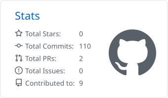
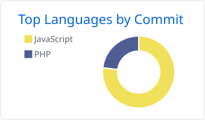

# Hi, I'm Conner 👋

**Developer from Bavaria, Germany** · building self-hosted tools

---

## 🛠️ Tech I work with

---

## 📊 GitHub

<picture>
  <source media="(prefers-color-scheme: dark)" srcset="profile-summary-card-output/github_dark/3-stats.svg">
  
</picture>
<picture>
  <source media="(prefers-color-scheme: dark)" srcset="profile-summary-card-output/github_dark/2-most-commit-language.svg">
  
</picture>

---

Made with ♥ in Bavaria

